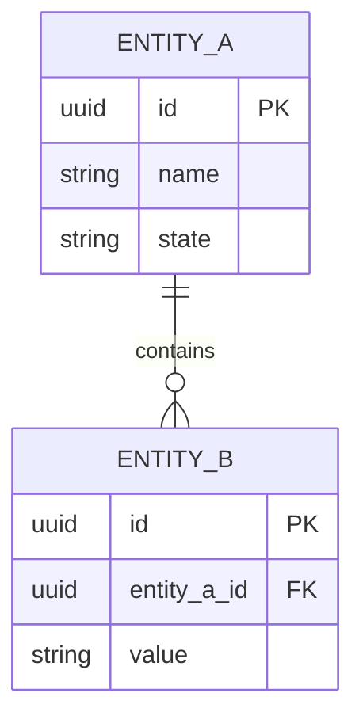

# Data Model: [FEATURE]

## Entities

- **[Entity 1]**: [What it represents, key attributes without implementation]
- **[Entity 2]**: [What it represents, relationships to other entities]

## Entity-Relationship Diagram

<!--
  Persistence view. The domain class diagram lives in plan.md.
  Keep both: class diagram = domain behavior; ER = persistence schema.
-->

## Fields and Constraints

| Entity | Field | Type | Constraints | Notes |
| :--- | :--- | :--- | :--- | :--- |
| EntityA | id | UUID | PK, not null | |
| EntityA | name | String | not null, max 120 | |
| EntityB | entity_a_id | UUID | FK, not null | |

## Validation Rules

- [Rule that cannot be expressed in the ER diagram]
- [State transition or invariant]

## State Transitions

<!--
  If the entity has a meaningful lifecycle, the state diagram belongs in spec.md.
  Reference it here instead of duplicating it.
-->

- See `spec.md` → State Diagram.
