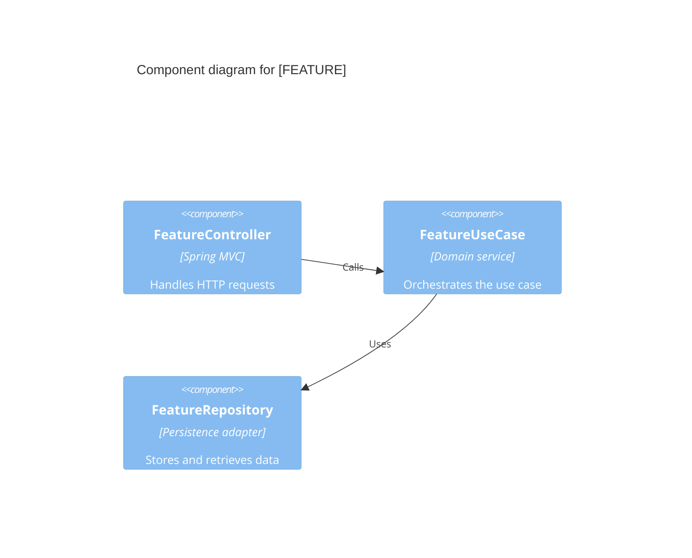
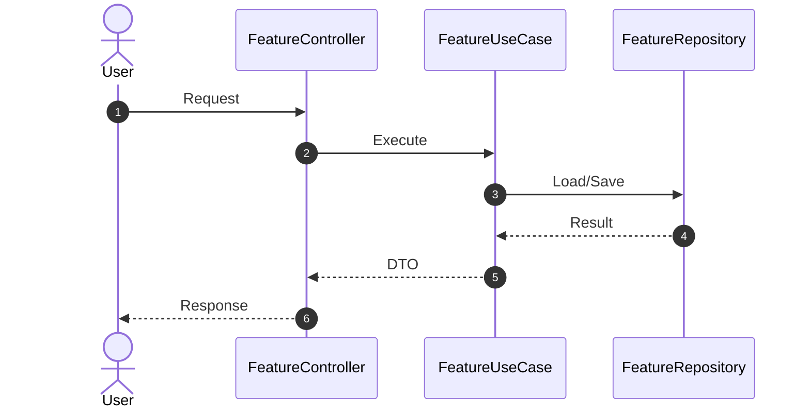
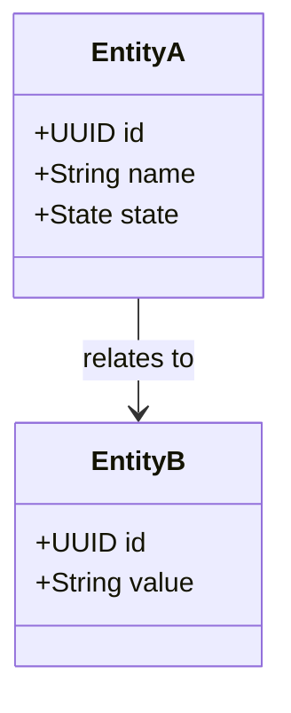

# Implementation Plan: [FEATURE]

**Branch**: `[###-feature-name]` | **Date**: [DATE] | **Spec**: [link]

**Input**: Feature specification from `/specs/[###-feature-name]/spec.md`

**Note**: This template is filled in by the `/speckit.plan` command; its definition describes the execution workflow.

## Summary

[2-3 lines: primary requirement + technical approach. Do not repeat the C4 diagram.]

## Technical Context

**Language/Version**: [e.g., Java 21, Dart 3.x or NEEDS CLARIFICATION]

**Primary Dependencies**: [e.g., Spring Boot 4, Flutter or NEEDS CLARIFICATION]

**Storage**: [if applicable, e.g., PostgreSQL or N/A]

**Testing**: [e.g., JUnit 5, Testcontainers, Flutter test or NEEDS CLARIFICATION]

**Target Platform**: [e.g., Linux server, Android, iOS, Web or NEEDS CLARIFICATION]

**Project Type**: [e.g., web-service, mobile-app, library or NEEDS CLARIFICATION]

**Performance Goals**: [domain-specific target or NEEDS CLARIFICATION]

**Constraints**: [domain-specific constraint or NEEDS CLARIFICATION]

**Scale/Scope**: [domain-specific scale or NEEDS CLARIFICATION]

## Constitution Check

*GATE: Must pass before Phase 0 research. Re-check after Phase 1 design.*

[Gates determined based on constitution file]

## Architecture — C4 Level 3 (Components)

<!--
  Feature-scoped component view. C4 L1/L2 live in constitution.md.
  If this feature does not change components, reference the relevant L2 container
  instead of duplicating the global architecture.
-->



## Sequence Diagram

<!--
  Key flow from the spec's activity diagram. Show technical calls, not business narrative.
-->



## Domain Model — Class Diagram

<!--
  Domain classes and relationships. The persistence ER diagram belongs in data-model.md.
  Keep both views: class diagram = domain behavior; ER = persistence schema.
-->



## Contracts

- API/UI contracts: [`contracts/`](contracts/)
- Data model and ER: [`data-model.md`](data-model.md)
- Quickstart validation: [`quickstart.md`](quickstart.md)

## Project Structure

### Documentation (this feature)

```text
specs/[###-feature]/
├── plan.md              # This file
├── research.md          # Phase 0 output
├── data-model.md        # Phase 1 output
├── quickstart.md        # Phase 1 output
├── contracts/           # Phase 1 output
└── tasks.md             # Phase 2 output
```

### Source Code (repository root)

```text
# [REMOVE IF UNUSED] Option 1: Single project (DEFAULT)
src/
├── models/
├── services/
└── lib/

tests/
├── contract/
├── integration/
└── unit/
```

**Structure Decision**: [Document the selected structure and reference the real directories]

## Complexity Tracking

> **Fill ONLY if Constitution Check has violations that must be justified**

| Violation | Why Needed | Simpler Alternative Rejected Because |
|-----------|------------|-------------------------------------|
| [e.g., 4th project] | [current need] | [why 3 projects insufficient] |
