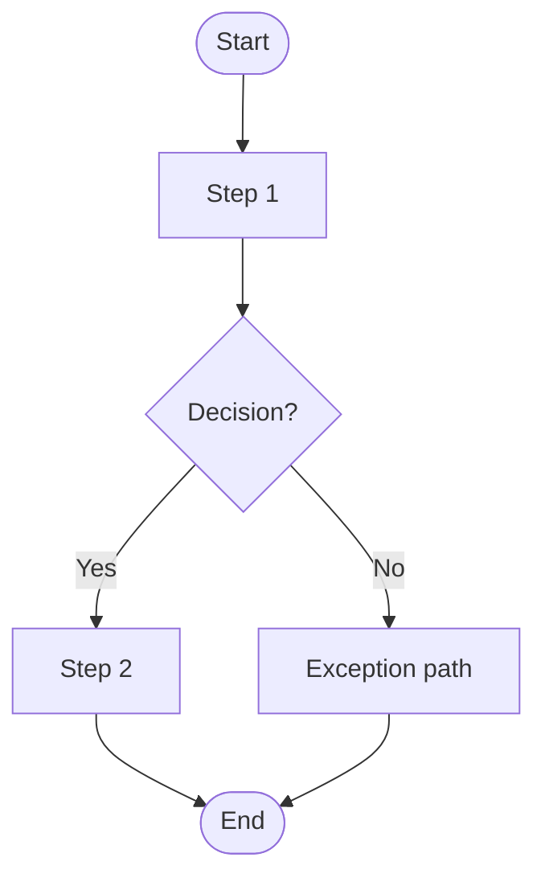
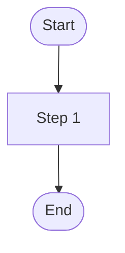
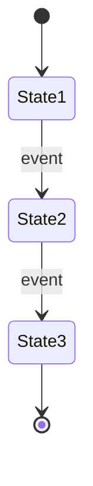

# Feature Specification: [FEATURE NAME]

**Feature Branch**: `[###-feature-name]`

**Created**: [DATE]

**Status**: Draft

**Input**: User description: "$ARGUMENTS"

<!--
  DIAGRAM-FIRST RULE
  - Use case diagram: scope and actors.
  - Activity/flow diagram: main and alternate flows.
  - State diagram: lifecycle of entities with states.
  - Text is complementary: intent, business rules, validation, acceptance criteria,
    non-functional requirements, edge cases, assumptions.
  - Do not repeat diagram steps in prose.
  - Keep the official section names and order.
-->

## User Scenarios & Testing *(mandatory)*

### Use Case Diagram

<!--
  One per feature. Replace the example actors and use cases.
  Mermaid 12+ syntax: usecase-beta.
  Declare every actor explicitly.
-->

```mermaid
usecase-beta
direction LR
actor Actor1("Actor 1")
systemBoundary System["System Under Design"]
  UseCase1("Use case 1")
end
Actor1 --> UseCase1
```

### User Story 1 - [Brief Title] (Priority: P1)

**Intent**: [2-3 lines describing the value and the business goal. Do not narrate the flow.]

**Why this priority**: [Explain the value and why it has this priority level]

**Independent Test**: [Describe how this can be tested independently]

**Activity / Flow Diagram**:

<!--
  Main flow and relevant alternate/exception flows.
  Replace the example nodes. Do not repeat these steps in the Intent.
-->



**Acceptance Scenarios**:

<!--
  Label every scenario with a stable, globally unique CA id (CA-1, CA-2, ...).
  @sdt-tester uses these ids as the traceability key.
-->

1. **CA-1** — **Given** [initial state], **When** [action], **Then** [expected outcome]
2. **CA-2** — **Given** [initial state], **When** [action], **Then** [expected outcome]

---

### User Story 2 - [Brief Title] (Priority: P2)

**Intent**: [2-3 lines describing the value and the business goal. Do not narrate the flow.]

**Why this priority**: [Explain the value and why it has this priority level]

**Independent Test**: [Describe how this can be tested independently]

**Activity / Flow Diagram**:


**Acceptance Scenarios**:

1. **CA-3** — **Given** [initial state], **When** [action], **Then** [expected outcome]

---

### User Story 3 - [Brief Title] (Priority: P3)

**Intent**: [2-3 lines describing the value and the business goal. Do not narrate the flow.]

**Why this priority**: [Explain the value and why it has this priority level]

**Independent Test**: [Describe how this can be tested independently]

**Activity / Flow Diagram**:



**Acceptance Scenarios**:

1. **CA-4** — **Given** [initial state], **When** [action], **Then** [expected outcome]

---

[Add more user stories as needed, each with an assigned priority]

### Edge Cases

<!--
  Text only: conditions that are not visible in the activity/state diagrams.
-->

- What happens when [boundary condition]?
- How does the system handle [error scenario]?

## Requirements *(mandatory)*

### Functional Requirements

- **FR-001**: System MUST [specific capability]
- **FR-002**: System MUST [specific capability]
- **FR-003**: Users MUST be able to [key interaction]
- **FR-004**: System MUST [data requirement]
- **FR-005**: System MUST [behavior]

*Example of marking unclear requirements:*

- **FR-006**: System MUST authenticate users via [NEEDS CLARIFICATION: auth method not specified]

### Non-Functional Requirements

<!--
  Only CU-specific NFRs. Global NFRs belong in constitution.md.
-->

- **NFR-001**: [Latency, concurrency, volume, availability, or compliance target]
- **NFR-002**: [Security, privacy, or audit requirement specific to this CU]

### Key Entities *(include if feature involves data)*

- **[Entity 1]**: [What it represents, key attributes without implementation]
- **[Entity 2]**: [What it represents, relationships to other entities]

### State Diagram

<!--
  One per entity with a meaningful lifecycle.
  Omit this section if no entity has states.
-->



## Success Criteria *(mandatory)*

### Measurable Outcomes

- **SC-001**: [Measurable metric, e.g., "Users can complete account creation in under 2 minutes"]
- **SC-002**: [Measurable metric, e.g., "System handles 1000 concurrent users without degradation"]
- **SC-003**: [User satisfaction metric]
- **SC-004**: [Business metric]

## Assumptions

- [Assumption about target users]
- [Assumption about scope boundaries]
- [Assumption about data/environment]
- [Dependency on existing system/service]
